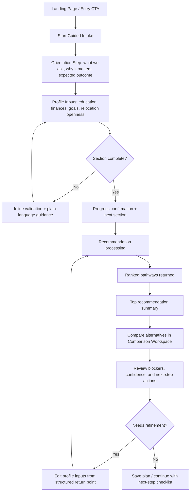
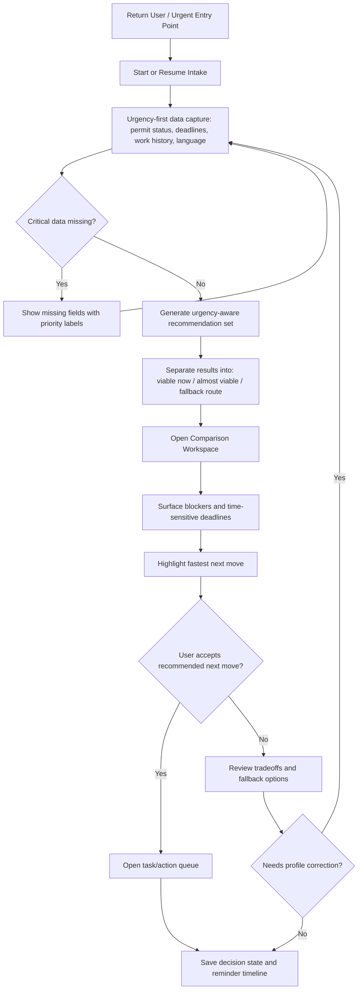
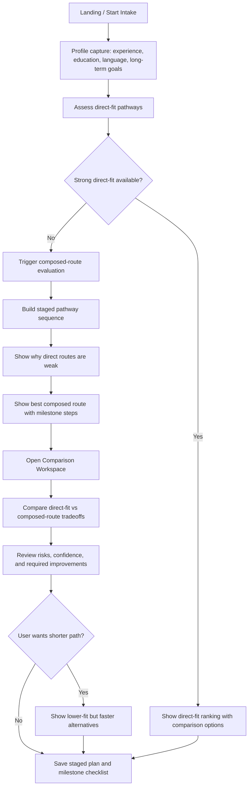
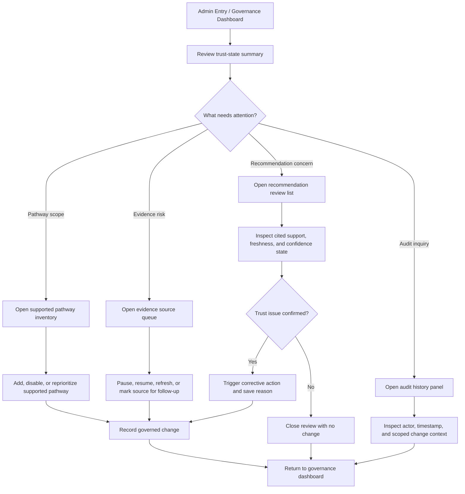

# UX Design Specification cadet2

**Author:** Wesleyukadike
**Date:** 2026-03-01

---

<!-- Stitch-first UX design content will be appended sequentially through collaborative workflow steps -->
<!-- Reserved sections populated during the workflow: Stitch Workspace, Design Tokens & Design System, Variant Exploration, Selected Direction, Stitch Artifact Registry -->

## Executive Summary

### Project Vision

cadet2 is a high-trust Canadian immigration planning platform that turns fragmented immigration information into clear, evidence-backed pathway guidance. The UX needs to help users move from uncertainty to a structured, actionable plan they can understand and trust.

### Target Users

The primary users are immigration-seeking individuals who need clarity on the best realistic route toward Canadian immigration goals. The current planning docs emphasize users like international students and temporary workers who are navigating uncertainty, time pressure, and high-stakes decisions.

### UX Planning Scope

This is an app-foundation engagement. The work described is not a single contained feature; it is the core product experience and needs shared shell patterns, a reusable design system, and a consistent recommendation journey.

### Product Context Mode

This is a brownfield engagement. The repo already has an existing Nuxt application, established component patterns, and a documented architecture that the UX direction should reuse rather than replace blindly.

### Key Design Challenges

The product must simplify a complex, trust-sensitive domain without feeling vague or generic.
The recommendation experience needs to balance depth, evidence, and clarity so users can understand why a pathway is suggested.
The UX must reduce anxiety and cognitive overload for users making life-impacting decisions under uncertainty.

### Design Opportunities

A strong guided intake and recommendation flow can make the product feel materially better than government pages, forums, and shallow quizzes.
Clear evidence presentation, citations, and next-step planning can become a core trust differentiator.
A well-designed reusable app foundation can support future pathway updates and repeated re-evaluation as user circumstances change.

## Core User Experience

### Defining Experience

The defining experience for cadet2 is a guided recommendation journey where users provide their personal, immigration, education, and work context, then receive a structured set of viable immigration pathways with clear rationale, evidence, and next actions. The one action users will do most often is submit, refine, and revisit their profile information so the system can produce better pathway recommendations over time.

The most critical interaction to get right is the transition from user input to recommendation output. If users do not immediately understand why a pathway is suggested, what makes it credible, and what to do next, the product loses trust. If this interaction is clear, confidence-building, and actionable, the rest of the experience becomes much easier to support.

### Platform Strategy

cadet2 should be designed as a responsive web application for now. The primary working assumption is that users will often complete deeper intake, compare options, and review detailed explanations on desktop or larger tablet screens, where form-heavy workflows and side-by-side decision support are easier to process.

Mobile responsiveness remains essential because users will still revisit recommendations, check next steps, and make quick updates from their phones. The UX should therefore support a desktop-first depth model without making mobile feel like a compromised afterthought. Core flows must remain fully usable on mobile, but dense analysis and comparison experiences should be optimized for progressive disclosure.

### Effortless Interactions

The intake flow should feel structured, calm, and low-friction rather than like an overwhelming long form. Users should always understand what information is being asked for, why it matters, and how it affects recommendation quality.

Recommendation review should feel immediately scannable. Users should be able to understand the top pathways, confidence signals, evidence basis, and next steps without having to decode jargon or hunt through the screen for meaning.

The experience should also make iteration effortless. Users should be able to refine their profile, adjust assumptions, and re-evaluate pathways without feeling like they are starting over. Saving progress, preserving context, and reducing repeated input are key to making the product feel materially better than fragmented alternatives.

### Critical Success Moments

The make-or-break moment is when the user sees their first recommendation set and thinks, "this is clearer, more relevant, and more useful than what I could piece together myself." That moment depends on relevance, clarity, and trust arriving together.

A second critical success moment is when the user can immediately identify a realistic next action. The experience should not stop at "here are your options." It should help the user understand what to do now, what improves their position, and what tradeoffs they are accepting.

The highest-risk failure point is any output that feels generic, unsupported, or hard to interpret. If the recommendation result feels vague or disconnected from the user's real situation, the overall product value collapses quickly.

### Experience Principles

Trust must be visible, not implied. Users should constantly see why the system is asking questions, why a pathway is recommended, and what supports the recommendation.

Complexity should be staged, not dumped. The UX should reveal depth progressively so users feel guided rather than overwhelmed.

Actionability beats abstraction. Every major screen should help users make a clearer decision or take a concrete next step.

Iteration should feel natural. Users should be able to revisit, refine, and improve their pathway strategy without friction or repeated setup.

## Desired Emotional Response

### Primary Emotional Goals

cadet2 should primarily make users feel calm, confident, and in control. The product is operating in a space where users often arrive with uncertainty, stress, and fragmented knowledge, so the emotional job of the interface is not to create excitement first. It is to create clarity and emotional steadiness.

A strong secondary goal is to make users feel supported and genuinely guided. The product should feel like a capable planning partner that helps users move forward, not like a cold calculator or an opaque rules engine.

The differentiating emotional response should be relief with momentum. Users should feel that something complex has become understandable, and that they now have a realistic next step.

### Emotional Journey Mapping

When users first arrive, they should feel welcomed, oriented, and less intimidated than they expect. The product should signal structure and competence early so users believe the experience will help them make sense of a difficult problem.

During the core intake and recommendation flow, users should feel guided rather than interrogated. As they move through the process, the emotional tone should shift from uncertainty toward confidence, with each step reinforcing that the system is using their information carefully and productively.

After receiving recommendations, users should feel clarity, trust, and practical motivation. They should leave with the sense that they understand their options better and know what to do next.

If something goes wrong or information is incomplete, users should still feel safe and supported rather than blamed or abandoned. Errors, edge cases, or low-confidence situations should be handled in a way that preserves trust and reduces panic.

When users return, they should feel continuity and progress. The experience should feel like they are picking up an evolving plan, not starting from zero again.

### Micro-Emotions

Confidence over confusion is essential. At every major decision point, the user should feel more certain about what the product is telling them and why.

Trust over skepticism is non-negotiable. Because the domain is sensitive and credibility matters, the interface has to consistently reinforce that recommendations are reasoned, evidence-backed, and specific to the user's situation.

Hope over anxiety is another critical emotional shift. The product cannot remove the stakes of immigration decisions, but it should reduce the sense of chaos and replace it with realistic optimism.

Accomplishment over frustration should define task completion. Finishing intake, reviewing recommendations, and identifying next steps should all feel like progress, not administrative burden.

### Design Implications

To support calm and confidence, the UX should use structured flows, clear sectioning, plain language, and progressive disclosure instead of dense walls of information or abrupt jumps between screens.

To support trust, the interface should make reasoning visible. Users should see why questions are being asked, why pathways are recommended, what evidence supports them, and what limitations or assumptions are in play.

To support relief and momentum, recommendation results should emphasize concrete next steps, strongest-fit pathways, and actionable improvement opportunities instead of dropping users into an unstructured list of possibilities.

Negative emotions to actively avoid include confusion, overwhelm, skepticism, and helplessness. The design should avoid vague outputs, unexplained jargon, hidden logic, and interaction patterns that make users feel they have wasted time.

### Emotional Design Principles

Use calm structure to reduce anxiety. The product should feel orderly, readable, and predictable, especially in moments of complexity.

Make trust tangible. Confidence should come from visible rationale, transparent evidence, and honest handling of uncertainty.

Turn clarity into momentum. Every important screen should help the user move from understanding to action.

Preserve dignity in high-stakes decisions. The product should never make users feel judged, careless, or lost when they are trying to navigate a difficult life decision.

## UX Pattern Analysis & Inspiration

### Inspiring Products Analysis

For cadet2, the most useful inspiration set is TurboTax, Google Flights, and Notion.

TurboTax is relevant because it turns a stressful, high-stakes process into a guided, stepwise flow. It does a strong job of breaking down intimidating topics into smaller decisions, explaining why questions matter, and reinforcing progress as users move forward. The transferable lesson is not the visual style itself, but the ability to make a consequential process feel manageable through sequencing, reassurance, and contextual guidance.

Google Flights is useful because it helps users compare multiple viable options without collapsing into confusion. It presents tradeoffs clearly, supports scanning and filtering, and helps users understand why one option may be better depending on priorities. For cadet2, this maps well to pathway comparison, where users need to understand strengths, weaknesses, timing, and tradeoffs across several routes.

Notion is valuable as a model for calm structure and continuity. It handles dense information with clear hierarchy, modular sections, and a sense of persistent workspace rather than one-off transactions. That pattern is relevant for cadet2 because users may return repeatedly to refine inputs, revisit recommendations, and continue an evolving planning process.

### Transferable UX Patterns

A guided, sectioned intake pattern should be adopted from products like TurboTax. This works for cadet2 because users are likely to arrive with incomplete confidence and fragmented information. Breaking intake into stages with visible progress, contextual explanation, and clear next actions reduces anxiety and improves completion.

A compare-and-choose decision pattern should be adapted from products like Google Flights. This is useful for cadet2 because pathway recommendations are rarely a single obvious answer. Users need a way to compare routes based on fit, timing, effort, and strategic value without getting buried in text.

A workspace continuity pattern should be adapted from products like Notion. cadet2 should feel like an evolving planning environment where users can revisit their context, update assumptions, and continue from where they left off. Persistent drafts, saved states, and structured sections support that goal.

Progressive disclosure is another critical pattern. Rather than showing every legal nuance at once, the interface should surface the highest-value summary first, then allow users to expand into evidence, assumptions, and detailed criteria only when needed.

### Anti-Patterns to Avoid

Avoid long, undifferentiated form experiences that feel like bureaucratic paperwork. If intake feels like a single giant questionnaire without clear segmentation or payoff, users will disengage.

Avoid black-box recommendation outputs. Users should never receive pathway suggestions without understanding why they were produced, what evidence supports them, and where uncertainty remains.

Avoid dense jargon-heavy result screens that resemble legal reference material more than a decision-support product. That would undermine the emotional goals of calm, clarity, and forward motion.

Avoid dead-end flows where users are told they are not eligible or lack sufficient information without being shown what to improve, what to clarify, or what alternative path to consider.

### Design Inspiration Strategy

Adopt guided sequencing, visible progress, and contextual explanation as core structural patterns because they directly support the product's need to reduce anxiety and build trust.

Adapt comparison and ranking patterns for pathway evaluation, but tailor them to high-trust decision support rather than purely transactional choice. cadet2 should compare options clearly while preserving nuance, rationale, and next-step actionability.

Adapt persistent workspace patterns so users can return to an evolving plan instead of restarting each session. This should reinforce the product as a planning companion rather than a disposable calculator.

Avoid patterns that make the product feel bureaucratic, opaque, or overwhelming. The design should borrow proven structures from strong products, but the final experience must remain distinct: calmer than finance dashboards, more actionable than research tools, and more transparent than generic recommendation engines.

## Stitch Workspace

### Project Binding

No Stitch workspace is currently bound from this workflow environment, but a single Stitch project has now been selected as the source of truth for this app-foundation exploration. The approved project is `6257021077077987630`. Because the workspace is not formally bound in the local workflow environment, `stitchWorkspaceBound` should remain `false` even though `stitchProjectId` is now set.

cadet2 should continue using this same dedicated Stitch project for all app-foundation exploration, token generation, screen variants, and final design comparisons. Once formal workspace binding is available, this project should become the only approved source for downstream UX generation in this workflow.

### Workspace Reuse Strategy

Because this is a brownfield product, the Stitch project should not start from a blank visual language. It should be informed by the existing Nuxt application, current component conventions, and the present UI primitive layer already in the repo.

That same rule applies to future reuse: review existing screens and component patterns before generating net-new directions. Existing screens should be treated as implementation constraints and signal, while the Stitch project becomes the place to normalize, refine, and extend the visual system into a cleaner app-wide foundation.

## Design System Foundation

### 1.1 Design System Choice

The recommended foundation for cadet2 is a themeable design system built on the existing shadcn-nuxt and Reka UI layer, extended with app-specific tokens and higher-order patterns for trust, guidance, and comparison-heavy workflows.

This is not a fully custom-from-scratch system, and it should not be treated as a generic off-the-shelf style either. The right approach is to keep the existing primitive component foundation, then layer a tailored visual and interaction system on top of it through shared tokens, semantic roles, and workflow-specific patterns.

### Rationale for Selection

The project already has an established component base in the codebase, including `app/components/ui/*`, Tailwind CSS variables, and a configured shadcn-style system. Reusing that foundation reduces implementation churn and keeps the design direction aligned with how the application is actually built.

A themeable system is the best fit because cadet2 needs a distinctive, trust-centered product feel without paying the cost of replacing the existing UI primitive layer. The product needs custom expression at the experience and token layer, not a ground-up reinvention of every button, dialog, and form primitive.

This also supports the app-foundation scope of the workflow. A reusable token-driven system will make it easier to generate consistent Stitch variants, responsive layouts, and future feature surfaces while preserving a unified visual language.

### Implementation Approach

Use the current primitive layer as the base: shadcn-nuxt components, Reka UI behavior, Tailwind utility styling, and CSS variable-driven theming. The next visual system step should define app-wide tokens for color roles, typography, spacing, radius, elevation, and state feedback that reflect the emotional goals of calm, trust, and forward motion.

On top of the primitives, define a smaller set of product-level patterns that repeat across the experience: guided intake sections, recommendation cards, evidence panels, comparison views, progress framing, and action-oriented next-step blocks. These patterns should become the real UX signature of cadet2.

When Stitch is available, the same workspace should be used to generate tokens, export the design system, and evaluate variants from this shared foundation rather than creating isolated one-off screens.

### Customization Strategy

Customize at the semantic layer, not the primitive mechanics layer. The system should introduce domain-specific meaning through token naming, layout patterns, hierarchy rules, and reusable content structures instead of rewriting stable interaction primitives unnecessarily.

The visual system should lean into calm clarity: restrained but confident color roles, strong information hierarchy, legible spacing, and clear emphasis states for priority actions and evidence-backed recommendations. It should feel more trustworthy and guided than flashy.

The system should also explicitly support responsive adaptation. Dense desktop comparison and analysis patterns should collapse into progressive, sectioned mobile flows without losing clarity. That means tokens and components need to be designed for both rich desktop depth and mobile-safe readability from the start.

## 2. Core User Experience

### 2.1 Defining Experience

The defining experience of cadet2 is: "Turn my personal situation into a clear immigration pathway plan I can trust."

In practical terms, this is a guided profile-to-plan interaction. The user provides structured context about their background, goals, status, education, and work history, and the system transforms that input into a prioritized set of plausible pathways with rationale, evidence, and next actions.

If this one interaction is excellent, the rest of the product follows. Users will describe the product not as "a site with immigration information," but as the place that helps them understand their best route and what to do next.

### 2.2 User Mental Model

Most users currently solve this problem through fragmented research: government websites, community forums, consultant content, ad hoc advice, and personal guesswork. Their mental model is usually a mix of "I need to figure out what I qualify for" and "I need someone to help me make sense of this."

That means users arrive expecting either a generic quiz, a bureaucratic form, or a confusing pile of information. They are likely to assume they will need to do substantial interpretation themselves unless the product proves otherwise quickly.

The main confusion points are likely to be:
why a question is being asked,
how a specific fact affects eligibility,
why one path is ranked above another,
and what to do when no option looks immediately ideal.

### 2.3 Success Criteria

The core experience succeeds when users feel that the system understood their situation, produced recommendations that feel specific rather than generic, and translated those recommendations into practical next actions.

Key success indicators are:
the user can complete intake without feeling overwhelmed,
the user immediately understands the top recommendation set and why each option appears,
the user can identify at least one concrete next step without outside interpretation.

The experience should feel responsive and progressive, with visible advancement through intake and clear payoff at the end. Users should never feel like they submitted a large amount of information only to receive vague or low-value output.

### 2.4 Novel UX Patterns

This experience should mostly use established patterns, but combine them in a way that feels meaningfully better than current alternatives.

The intake flow should use familiar guided-form and step-based patterns so users do not need to learn a new interaction model. The recommendation output should use familiar comparison, ranking, and expandable-detail patterns so the result feels immediately legible.

The unique twist is the combination: a calm guided intake feeding directly into an explainable, evidence-oriented planning surface. The product does not need a novel gesture or exotic UI pattern. Its innovation is in how familiar patterns are sequenced to create a clearer and more trustworthy decision-support experience.

### 2.5 Experience Mechanics

**1. Initiation:**
The user is invited into a guided planning flow with clear framing about what the product will do, what information will be needed, and what outcome they will receive. The trigger should feel low-risk and understandable, not like starting a legal application.

**2. Interaction:**
The user progresses through structured sections of profile input. Each section asks for specific information with contextual explanation, uses familiar controls, and reduces unnecessary repetition. The system should continuously reinforce progress and maintain a sense of orientation.

**3. Feedback:**
Users receive immediate structural feedback during intake, including progress, completion cues, and clear validation when information is missing or unclear. Once recommendations are generated, feedback becomes explanatory: why a pathway appears, what affects fit, what assumptions are in play, and what the user can improve.

**4. Completion:**
The interaction is complete when the user reaches a recommendation surface that presents ranked or grouped pathways, supporting evidence, and concrete next-step actions. The successful outcome is not just "results displayed"; it is the user leaving with clarity, confidence, and an actionable plan. The natural next move is to compare options, save the plan, or refine their profile to improve the recommendation set.

## Design Tokens & Design System

### Stitch Design System Source of Truth

`DESIGN.md` should be the human-readable semantic source of truth for the cadet2 design system. It should describe the product's visual intent in plain language: trust-first, calm, structured, and action-oriented. It should define how color roles, typography hierarchy, spacing, component patterns, and interaction states are meant to feel and be used across the app.

Because no Stitch workspace is bound yet in this environment, `DESIGN.md` should be treated as the immediate canonical reference until the Stitch project is connected. Once Stitch is available, `DESIGN.md` should stay aligned with the approved workspace outputs rather than diverging into a separate parallel system.

The design system must explicitly support both light mode and dark mode. Theme behavior should be token-driven, with the same semantic roles preserved across both themes rather than maintaining two disconnected visual systems.

### Token Families

The app-wide token families should include:
color,
typography,
spacing,
radius,
shadow/elevation,
and motion/timing.

Color tokens should be semantic rather than decorative, with roles for surface, text, muted text, border, accent, success, warning, destructive, and trust-signaling highlights. Each color role should have light-mode and dark-mode values defined from the start.

Typography tokens should define readable hierarchy for dense informational UX: display, h1, h2, h3, body, secondary body, caption, and data labels.

Spacing tokens should be built on an 8px base system, with compact substeps where needed for dense UI. Radius tokens should support a soft but professional feel rather than sharp or overly playful edges.

Shadow and elevation tokens should stay restrained, using depth to clarify hierarchy rather than create visual drama. Motion tokens should prioritize subtle reassurance and orientation over flourish.

### Token Export Artifacts

The required design-system artifacts are:
`_bmad-output/planning-artifacts/DESIGN.md`
`_bmad-output/planning-artifacts/design-tokens.json`
`_bmad-output/planning-artifacts/design-tokens.css`

`DESIGN.md` is the semantic UX reference for product and design decisions. `design-tokens.json` should be the machine-readable export for future tooling, transformations, and design automation. `design-tokens.css` should expose the implementation-facing CSS variable layer that maps directly into the existing Tailwind and shadcn-style setup, including both light and dark theme token values.

If a Stitch workspace is connected later, any exported style guide or token registry should map back to these same artifact paths so there is still one consistent source of truth.

### Color System

The color strategy should communicate clarity, stability, and confidence in both themes. The current `neutral` shadcn base is an appropriate starting point, but cadet2 should introduce a restrained trust accent rather than rely on gray alone.

In light mode, the surface system should remain light, clean, and high-contrast for readability: soft neutral backgrounds, crisp foreground text, and clearly defined borders. Accent usage should be controlled and purposeful, primarily for calls to action, progress states, trust signals, and important recommendation emphasis.

In dark mode, the interface should preserve the same calm and trustworthy tone without becoming overly saturated or harsh. Dark surfaces should be deep but not pure black, text should remain comfortably readable, and borders should be subtle but still visible enough to maintain structure in dense information layouts.

A blue-leaning trust accent is the strongest fit here because it supports confidence and professionalism across both themes if tuned carefully. Success states should feel constructive, warning states should feel clear but non-alarming, and destructive states should be reserved for true risk or invalid actions only.

The palette should avoid looking like a finance dashboard or legal form portal in either mode. It should feel calmer, more supportive, and more legible than bureaucratic systems.

### Typography System

The typography should feel modern, clear, and dependable. The product will contain substantial explanatory content, so readability matters more than novelty.

The primary type system should favor a highly legible sans serif for both interface and body copy. Headings should create strong hierarchy without feeling editorial or overly branded. Body text must remain comfortable for explanatory content, evidence notes, and multi-step guidance.

The type scale should support:
a strong but controlled display size for key page framing,
clear H1-H3 hierarchy for major sections,
comfortable body sizing for instructional and explanatory text,
smaller secondary text for supporting evidence, hints, and metadata.

Line heights should err on the side of readability, especially in recommendation and evidence-heavy screens. Contrast and text sizing should be accessible by default in both light and dark mode, with no reliance on tiny muted text for important meaning.

### Spacing & Layout Foundation

The spacing system should use an 8px base scale, with enough flexibility to support both content density and calm presentation. This is the best fit for a responsive web app that needs structured forms, comparison layouts, and information-heavy result screens.

The layout should feel ordered and breathable, not sparse. Intake screens should use sectional chunking and predictable vertical rhythm. Recommendation screens should use stronger grouping, clear separation, and visible hierarchy so users can scan pathways, evidence, and next steps without cognitive overload.

Desktop layouts should support richer side-by-side comparison and contextual panels. Mobile layouts should collapse into stacked sections with progressive disclosure while preserving the same information architecture.

The layout principles should be:
group related decisions together,
show one layer of complexity at a time,
and maintain visible orientation through consistent headers, progress framing, and content boundaries.

Theme changes should not alter layout logic. Light and dark mode should share the same spacing, structure, and interaction hierarchy so users experience visual continuity across themes.

### Accessibility Considerations

Accessibility should be treated as a trust requirement, not a compliance afterthought. Text contrast, readable type sizing, clear focus states, and keyboard-safe interactions are mandatory because users must be able to process high-stakes information without friction.

Color must never be the only signal for meaning. Status, confidence, recommendation priority, and warnings should all have textual or structural reinforcement.

Dense content areas should support scannability through spacing, headings, and section labels rather than relying on visual styling alone. Motion should be subtle and reducible, with transitions used to support orientation rather than distract from content.

Because the product includes complex information and decision support, cognitive accessibility matters as much as technical accessibility. The token system should support consistency, predictability, and progressive disclosure across every core flow in both light and dark themes.

## Variant Exploration

### Refined Layout-2 Variants

Three refined variants were generated from the modular dashboard direction so the team could stay within the strongest overall shell pattern while testing different emphasis models.

`Progress Hub` focuses on continuity, progress framing, and a strong resume flow.
Mobile: `644856989f9a485da113a32a267fc4b2`
Tablet: `ba5f27202f2640b9aabd689567537a7a`
Desktop: `5853854a55e1466e979995b699bf6f4b`

`Comparison Workspace` focuses on side-by-side pathway evaluation, recommendation context, and evidence-backed decision support.
Mobile: `2d7501846dd44d8a8bc52b9742494a71`
Tablet: `dc826e99abc34ba29c8a985158de51e9`
Desktop: `3a4bf4f2083e46d89b219ab72563bf1a`

`Evidence & Tasks` focuses on readiness tracking, document completion, and action queue management.
Mobile: `a8bbe3f9604543ab8e6f4eddb64d493b`
Tablet: `cbe3a8c5330a488ead66c5c76c15706f`
Desktop: `34bd9708e6764ade9b02545731f6af4c`

### Responsive Direction Strategy

For this round, the chosen implementation rule is not to stretch one layout across breakpoints. Instead, each approved direction should use distinct device-specific compositions where needed.

Desktop should use the dedicated desktop composition.
Mobile should use the dedicated mobile composition.
Tablet can remain a separate companion composition when that breakpoint needs a specialized layout, but it is not the primary approval anchor for this Step 9 decision.

## Selected Direction

### Approved Variant

The approved Step 9 direction is `Comparison Workspace`.

The selected desktop source is the Stitch screen:
`3a4bf4f2083e46d89b219ab72563bf1a`

The selected mobile companion is the Stitch screen:
`2d7501846dd44d8a8bc52b9742494a71`

The selected tablet companion remains available as:
`dc826e99abc34ba29c8a985158de51e9`

### Approval Rationale

This direction best preserves the calm, modular dashboard language while still supporting side-by-side analysis for a high-stakes immigration decision. It keeps the app feeling product-like instead of bureaucratic, but it gives users enough structure to compare pathways, review assumptions, and understand recommendation confidence.

The explicit device pairing is:
use the desktop-specific comparison workspace for desktop,
use the mobile-specific comparison workspace for mobile,
and keep the tablet-specific comparison workspace as an optional dedicated breakpoint layout.

### Implementation Guidance

The core information architecture should remain consistent across devices:
top-level recommendation framing,
clear comparison of viable pathways,
visible evidence or trust context,
and direct next-step actions.

What should change by device is the composition:
desktop should preserve the side rail, wider comparison surface, and contextual side panel;
mobile should collapse into a stacked modular flow with progressive disclosure;
tablet should use a split review layout rather than either a stretched phone layout or a compressed desktop clone.

## Stitch Artifact Registry

### Approved Stitch Project

Project ID: `6257021077077987630`

### Approved Screen Set

Primary approved direction: `Comparison Workspace`
Desktop: `3a4bf4f2083e46d89b219ab72563bf1a`
Mobile: `2d7501846dd44d8a8bc52b9742494a71`
Tablet companion: `dc826e99abc34ba29c8a985158de51e9`

### Supporting Exploration Artifacts

`Progress Hub`
Mobile: `644856989f9a485da113a32a267fc4b2`
Tablet: `ba5f27202f2640b9aabd689567537a7a`
Desktop: `5853854a55e1466e979995b699bf6f4b`

`Evidence & Tasks`
Mobile: `a8bbe3f9604543ab8e6f4eddb64d493b`
Tablet: `cbe3a8c5330a488ead66c5c76c15706f`
Desktop: `34bd9708e6764ade9b02545731f6af4c`

## User Journey Flows

### Ada: Guided Intake to Strategic Plan

Ada needs a calm, structured intake that turns uncertainty into a clear long-range plan. This flow must make the product feel more intelligent than a quiz and more actionable than a content library.

The core success condition is that Ada leaves with:
a ranked set of plausible pathways,
an explanation of why they fit,
and a concrete list of decisions she should make now to improve her future position.

Where confusion is most likely:
during intake scope, when Ada is unsure why a question matters, and at the moment a stronger pathway is not immediately available.

Recovery strategy:
each section should explain impact in plain language, and the result surface should distinguish:
available now,
available later,
and what specifically moves a pathway upward.

### Daniel: Deadline Re-Evaluation Under Time Pressure

Daniel needs fast clarity, not broad exploration. The flow should reduce time-to-answer while preserving evidence and tradeoff visibility.

The core success condition is that Daniel can identify:
what is viable now,
what is blocked,
and the single highest-payoff action to take immediately.

Where confusion is most likely:
when multiple pathways appear but only one is truly actionable under current timing constraints.

Recovery strategy:
the UI should explicitly label:
best immediate path,
stronger but blocked path,
and fallback path,
so Daniel never has to infer urgency from dense detail.

### Miriam: Non-Obvious Route Discovery and Staged Planning

Miriam needs strategic reorientation, not rejection. The flow should surface composed routes without making them feel speculative or magical.

The core success condition is that Miriam understands:
the sequence,
the logic behind each stage,
and the tradeoffs or risks attached to a longer-horizon route.

Where confusion is most likely:
when a composed route is more realistic than a direct route but takes longer and requires staged improvement.

Recovery strategy:
the result should separate:
current ineligibility,
future viability,
and milestone-based improvement actions,
with explicit confidence and caveat language.

### Internal Admin/Ops: Trust Governance and Quality Maintenance

The internal admin/ops user needs a clear operational flow for maintaining trust quality without relying on hidden institutional memory. This flow should support deliberate governance work: adjusting pathway scope, reviewing evidence quality, validating recommendation trustworthiness, and inspecting audit history.

The core success condition is that the admin user can:
identify a trust-risk quickly,
take a corrective action confidently,
and confirm the system recorded that action in a reviewable way.

Where confusion is most likely:
when a change appears operationally small but has broader trust impact, and when the admin needs to understand whether they are editing active recommendation behavior or only reviewing historical evidence.

Recovery strategy:
the interface should distinguish:
scope control,
evidence quality control,
recommendation trust review,
and audit inspection,
with explicit change-impact framing and visible confirmation of what was changed.

### Journey Patterns

Across these flows, a few reusable patterns should be standardized.

Navigation Patterns
- Use a guided intake shell with explicit progress, section framing, and resumable checkpoints.
- Use the approved `Comparison Workspace` as the shared decision surface after recommendations are generated.

Decision Patterns
- Always separate “available now” from “blocked but close” from “longer-horizon route.”
- Let users edit profile inputs from the exact decision point that triggered uncertainty instead of restarting the journey.

Feedback Patterns
- Use plain-language validation during intake to explain why missing inputs matter.
- Use structured confidence, blocker, and next-step modules so users can understand recommendation quality without interpreting raw legal detail.

Trust Patterns
- Show evidence context, assumptions, and caveats alongside recommendations.
- Never hide uncertainty; downgrade confidence visibly when evidence or user data is incomplete.

### Flow Optimization Principles

These flows should be optimized around speed to clarity, not speed to completion alone.

- Minimize steps to first credible recommendation, especially for urgent users.
- Reduce cognitive load by revealing one layer of complexity at a time.
- Preserve cross-device information architecture while changing composition by breakpoint.
- Keep recommendation explanation close to the comparison surface so users do not context-switch.
- Treat refinement as a normal loop, not as failure; profile edits should feel expected and low-friction.
- Make accomplishment visible through progress states, saved-plan confirmation, and action-ready next steps.
- Support safe recovery at every critical point: missing data, weak evidence, blocked pathway, or changing user constraints.

## Component Strategy

### Design System Components

The base component layer should continue using the existing shadcn-nuxt and Reka UI foundation already present in the codebase. This covers the shared primitives needed for consistent product construction and reduces unnecessary custom build effort.

Foundation components that should be reused directly include:
buttons,
inputs,
selects,
checkboxes,
radios,
textareas,
cards,
badges,
tabs,
dialogs,
drawers,
tooltips,
accordions,
dropdown menus,
tables,
scroll areas,
and form validation wrappers.

These should be treated as the default implementation layer for both mobile and desktop. They already solve most structural, focus, state, and accessibility concerns. The UX strategy should therefore avoid rebuilding primitives that are already solved.

### Stitch Component Inventory

The approved Stitch direction and its companion screens provide a practical pattern inventory that should be treated as the visual reference layer on top of the design system primitives.

Patterns clearly present in the approved `Comparison Workspace` set include:
a persistent side navigation rail for desktop,
a compact top header with contextual actions,
a summary band for recommendation framing,
comparison cards or comparison rows,
status badges for fit and urgency,
evidence-confidence or rationale side panels,
action queue modules,
guidance notices,
and stacked mobile content groups with progressive disclosure.

These are not all custom low-level components. Some are compositions built from primitives. The important implementation decision is to preserve their structure and reuse them as higher-order app patterns rather than recreating a new layout logic per screen.

### Custom Components

### RecommendationSummaryBand

**Purpose:** Establish the top-level recommendation framing before users enter detailed comparison.
**Usage:** Use at the top of result and re-evaluation surfaces.
**Anatomy:** Title, summary statement, confidence/fit signal, optional primary action, optional timestamp or freshness note.
**States:** default, loading, refreshed, low-confidence, degraded evidence.
**Variants:** desktop full-width, mobile stacked.
**Accessibility:** semantic heading structure, clear text equivalents for confidence and status, keyboard-reachable actions.
**Content Guidelines:** Keep summary language plain, decisive, and caveated when needed.
**Interaction Behavior:** May trigger refresh, refinement, or expand into more detail.

### PathwayComparisonCard

**Purpose:** Present one immigration pathway in a scannable, comparable format.
**Usage:** Use in desktop side-by-side comparison and mobile stacked result lists.
**Anatomy:** Pathway name, fit label, score or readiness signal, key tradeoffs, blockers, primary and secondary actions.
**States:** default, highlighted/best-fit, blocked, low-confidence, disabled, loading.
**Variants:** desktop column card, mobile stacked card, compact list item.
**Accessibility:** Use clear labels for score meaning, never rely on color alone for fit or risk, full keyboard focus order.
**Content Guidelines:** Show only the most decision-relevant facts first; defer dense detail behind expansion.
**Interaction Behavior:** Opens deeper pathway detail, can be selected for side-by-side comparison, can route into next-step flows.

### BlockerAndTradeoffPanel

**Purpose:** Translate recommendation complexity into understandable constraints and choices.
**Usage:** Use adjacent to pathway details or within a comparison context.
**Anatomy:** Blocker list, severity/priority labels, tradeoff statements, recommended resolution steps.
**States:** no blockers, some blockers, high-risk blocker, incomplete input.
**Variants:** right-side desktop panel, inline mobile section.
**Accessibility:** Each blocker requires textual labeling and clear action linkage.
**Content Guidelines:** Separate factual blockers from recommendations so users understand what is true vs. what is suggested.
**Interaction Behavior:** Allows users to jump directly back to the relevant intake or evidence section.

### EvidenceConfidencePanel

**Purpose:** Show why a recommendation can be trusted and where uncertainty remains.
**Usage:** Use in comparison and final recommendation views.
**Anatomy:** confidence indicator, citation freshness, assumptions, caveats, supporting references.
**States:** strong evidence, mixed evidence, weak evidence, stale evidence.
**Variants:** sidebar panel, expandable mobile accordion.
**Accessibility:** Confidence must be text-first and not color-only; references must be keyboard accessible.
**Content Guidelines:** Prefer concise plain-language trust framing over dense legal wording.
**Interaction Behavior:** Expands to reveal assumptions, references, and update context.

### NextActionQueue

**Purpose:** Turn recommendation output into a prioritized execution list.
**Usage:** Use after users review comparison output and in return-visit planning surfaces.
**Anatomy:** action title, urgency, dependency, due window, completion state, optional jump target.
**States:** queued, in progress, completed, blocked, overdue.
**Variants:** checklist module, timeline module, compact reminder strip.
**Accessibility:** Use explicit labels for priority and completion; ensure full keyboard toggling where interactive.
**Content Guidelines:** Phrase each action as a concrete, user-owned next move.
**Interaction Behavior:** Can mark completion, open linked detail, or route users back into data correction.

### MilestoneRoutePlanner

**Purpose:** Explain non-obvious or composed pathways as staged plans.
**Usage:** Use when a user has no strong direct-fit route or when a staged route is superior.
**Anatomy:** ordered milestones, requirements, dependencies, expected gains, risks, review points.
**States:** suggested, active, partially complete, invalidated by profile change.
**Variants:** desktop timeline, mobile stepped stack.
**Accessibility:** Milestones must have readable sequencing and textual risk labels.
**Content Guidelines:** Keep the path explicit, causal, and non-speculative.
**Interaction Behavior:** Lets users inspect each stage and understand what unlocks the next one.

### Component Implementation Strategy

The implementation approach should separate primitives, composed patterns, and domain components.

**Foundation Components**
Use the existing UI primitives directly for:
form inputs,
disclosure controls,
cards,
badges,
dialog containers,
tabs,
tables,
and layout scaffolding.

**Composed App Patterns**
Build shared compositions from those primitives for:
desktop side rail + header shell,
recommendation summary bands,
comparison surfaces,
evidence side panels,
and action queue modules.

**Custom Domain Components**
Reserve custom implementation effort for:
`RecommendationSummaryBand`,
`PathwayComparisonCard`,
`BlockerAndTradeoffPanel`,
`EvidenceConfidencePanel`,
`NextActionQueue`,
and `MilestoneRoutePlanner`.

All custom components should:
use the existing token layer,
inherit shared spacing and typography rules,
support both mobile and desktop compositions,
and map directly to the approved Stitch screen set so story creation can reference them consistently.

### Implementation Roadmap

**Phase 1 - Core Recommendation Components**
- `RecommendationSummaryBand` for result framing across all recommendation screens
- `PathwayComparisonCard` for the approved comparison workspace
- `BlockerAndTradeoffPanel` for immediate decision clarity

**Phase 2 - Trust and Action Components**
- `EvidenceConfidencePanel` to reinforce credibility and explain uncertainty
- `NextActionQueue` to convert recommendations into execution steps

**Phase 3 - Advanced Planning Components**
- `MilestoneRoutePlanner` for composed and non-obvious routes
- Additional specialized wrappers for saved plans, revisit flows, and advisor-facing support if those become part of near-term scope

This roadmap keeps implementation aligned with user-journey criticality:
first make recommendations legible,
then make them trustworthy,
then make longer-horizon planning more sophisticated.

## UX Consistency Patterns

### Button Hierarchy

**When to Use:** Use a strict action hierarchy so users can always tell the next best move in high-stakes decision moments.

**Visual Design:**
Primary actions should use the trust accent and be reserved for the most important forward-moving action on a screen, such as:
re-run analysis,
start application,
save plan,
or upload required evidence.

Secondary actions should be visually quieter and support exploration, such as:
view details,
compare alternatives,
or review evidence.

Tertiary actions should be text-like or minimally framed and used for low-risk actions such as:
cancel,
dismiss,
or return to edit.

Destructive actions should be visually distinct and used only for irreversible or high-risk operations.

**Behavior:**
A screen should usually have one clear primary action.
If multiple actions exist, the hierarchy must reflect recommendation priority and urgency.
Buttons should show loading states when actions trigger processing.
Users should never lose context after a high-value action; the UI should confirm what changed.

**Accessibility:**
Buttons must have descriptive labels, visible focus states, and non-color-only priority cues.
Disabled actions must still explain why they are unavailable when relevant.

**Mobile Considerations:**
Primary actions should remain thumb-reachable and may become full-width in mobile stacks.
Action density should be reduced on mobile so priority stays obvious.

**Variants:**
primary,
secondary,
tertiary,
destructive,
loading,
and disabled.

### Feedback Patterns

**When to Use:** Use explicit feedback any time the system validates input, generates recommendations, detects blockers, or encounters weak evidence.

**Visual Design:**
Success feedback should feel calm and confirming, not celebratory or noisy.
Warning feedback should signal caution without panic.
Error feedback should be precise and actionable.
Info feedback should clarify assumptions, freshness, or neutral state changes.

Confidence indicators should be shown as text-forward trust modules, not decorative badges alone.

**Behavior:**
Every meaningful action should produce one of:
confirmation,
progress,
warning,
or recovery guidance.

Recommendation feedback should always distinguish:
strong fit,
partial fit,
blocked,
and low-confidence.

If evidence is stale or incomplete, the system should degrade visibly and explain the consequence.

**Accessibility:**
Feedback must include text labels, not color only.
Critical messages should be announced appropriately for assistive tech when triggered dynamically.

**Mobile Considerations:**
Feedback should appear close to the action that caused it.
Long guidance should collapse into expandable sections on mobile.

**Variants:**
success,
warning,
error,
informational,
low-confidence,
and stale-evidence.

### Form Patterns

**When to Use:** Use structured, section-based forms for intake, refinement, and evidence updates.

**Visual Design:**
Forms should be chunked into clear sections with short explanatory framing.
Labels should be explicit and plain-language.
Helper text should explain why a field matters, especially where the answer affects recommendation quality.
Validation should be inline and close to the field.

**Behavior:**
The intake flow should support progressive disclosure and visible progress.
Users should be able to save progress and resume.
When recommendations are blocked by missing or weak data, forms should reopen at the exact correction point rather than restart.

Validation should distinguish:
required missing information,
invalid format,
and optional but recommendation-improving information.

**Accessibility:**
All fields need associated labels, helpful error text, and keyboard-safe progression.
Error summaries should be available when multiple issues exist.

**Mobile Considerations:**
Long forms should be broken into smaller steps.
Inputs should be spaced for touch and avoid dense multi-column layouts.

**Variants:**
guided step form,
inline edit form,
evidence upload form,
and fast correction form.

### Navigation Patterns

**When to Use:** Use navigation patterns that keep users oriented between intake, comparison, saved plans, and action execution.

**Visual Design:**
Desktop should use persistent structural navigation for major areas and contextual navigation inside the active workspace.
Mobile should collapse global navigation into a simpler bottom or top compact pattern while preserving the same information architecture.

Users should always know:
where they are,
what stage they are in,
and how to return to the prior decision point.

**Behavior:**
Navigation should preserve state where possible.
Returning from details to comparison should restore the user’s comparison context.
Editing profile data from a blocker should route the user back to the relevant field and then return them to the recommendation surface after update.

Progress framing should be visible during intake and refinement flows.

**Accessibility:**
Navigation landmarks, page titles, and active-state indicators should be explicit.
Keyboard users must be able to move between major regions predictably.

**Mobile Considerations:**
Avoid deep navigation nesting.
Use progressive disclosure instead of routing users through unnecessary screen stacks.

**Variants:**
desktop side rail,
contextual top header,
mobile condensed nav,
progress-step navigation,
and return-to-context navigation.

### Governance Review Patterns

**When to Use:** Use governance review patterns for internal admin and ops workflows that manage supported pathways, evidence quality, recommendation trust, and audit inspection.

**Visual Design:**
Desktop should use dense but structured review surfaces: sortable tables, filtered queues, contextual side panels, and scoped action bars.
Tablet should preserve the same information architecture with simplified density and touch-safe controls.
Mobile may support practical inspection and lightweight approval flows, but the primary authoring and review experience should remain desktop-first.

Users should always know:
what object they are reviewing,
whether they are editing active behavior or reviewing historical state,
and what operational impact their action will have.

**Behavior:**
Governance screens should separate:
inventory management,
evidence review,
recommendation review,
and audit history.
Each corrective action should require clear scope framing, preserve return-to-context behavior, and show explicit confirmation after save.
Bulk actions should be limited to cases where the affected scope is unambiguous.

**Accessibility:**
Review tables, action menus, filters, and audit panels must remain keyboard reachable, screen-reader understandable, and text-explicit for risk, warning, and action states.
Trust-state labels must never rely on color alone.

**Mobile Considerations:**
On small screens, review queues should collapse into stacked rows with expandable detail, while preserving action clarity and confirmation messaging.
Do not hide audit rationale or trust warnings simply to reduce density.

**Variants:**
pathway inventory table,
evidence review queue,
recommendation review queue,
audit history panel,
and corrective-action confirmation state.

### Additional Patterns

#### Modal and Overlay Patterns

Use modals only for focused tasks, confirmations, or short supporting flows.
Do not place dense pathway comparison or core recommendation review inside modals.
Drawers may be used on mobile for secondary detail, filters, or evidence notes.

#### Empty States

Empty states should always tell users:
why the state is empty,
what it means,
and what action to take next.

For recommendation-empty states, the product should prefer “not enough information yet” or “no strong fit right now” over generic zero-result messaging.

#### Loading States

Loading states should preserve layout structure with skeletons or progress indicators.
Recommendation generation should use explicit progress framing so users understand that the system is analyzing their profile rather than freezing.

#### Search and Filtering Patterns

Search and filtering should prioritize clarity over power-user density.
Filters should help users narrow pathways, evidence, or tasks without obscuring the default best-fit recommendation hierarchy.
On mobile, filters should open in a clear temporary layer and return users to the same scroll/context position.

### Design System Integration

These patterns should sit on top of the existing design-system primitives rather than replace them.

The design system handles the base interaction mechanics.
The product-specific patterns define:
how those primitives are combined,
which hierarchy rules apply,
and how trust, evidence, and next-step clarity are expressed consistently.

Custom pattern rules should be:
always show one dominant action per decision surface,
always distinguish recommendation quality from recommendation availability,
and always route users back into context-preserving correction loops rather than dead ends.

## Responsive Design & Accessibility

### Responsive Strategy

cadet2 should use a desktop-first depth model with dedicated mobile layouts, not simple responsive shrinking.

Desktop Strategy
Desktop is the primary decision-support environment. It should use:
multi-column layouts,
persistent side navigation where appropriate,
comparison surfaces with visible context,
and supporting side panels for evidence, blockers, and next actions.

Desktop should carry the highest information density, but that density must stay structured and scannable. The user should be able to compare pathways, inspect confidence, and act without excessive page-hopping.

Tablet Strategy
Tablet should use a touch-optimized split layout rather than either a stretched phone view or a compressed desktop clone.
It is best suited for:
two-column review,
contextual side modules,
and touch-friendly comparison and planning tasks.

Tablet should preserve the same information architecture as desktop, but simplify density and reduce simultaneous visual complexity.

Mobile Strategy
Mobile should use a dedicated stacked composition focused on progressive disclosure.
The most important mobile priorities are:
top recommendation clarity,
visible blockers,
trust context,
and immediate next-step actions.

Mobile should not attempt to show every comparison detail at once. It should sequence information in a clear order and allow expansion into deeper detail only when needed.

### Breakpoint Strategy

The breakpoint model should follow a practical responsive structure with product-specific behavior:

- Mobile: `320px - 767px`
- Tablet: `768px - 1023px`
- Desktop: `1024px+`

This product should keep those standard breakpoints, but treat them as behavior shifts, not just layout changes.

Breakpoint Intent
- At mobile widths, collapse into stacked sections with reduced simultaneous complexity.
- At tablet widths, introduce split review layouts and touch-friendly dual-panel structures.
- At desktop widths, enable full comparison workspace behavior with side rails, wider comparison bands, and contextual support panels.

The implementation should still be mobile-safe, but the product is not truly mobile-first in information depth. It is desktop-first in analytical depth and mobile-first in usability discipline.

### Accessibility Strategy

cadet2 should target **WCAG 2.1 AA** as the default standard.

That is the correct level because the product supports high-stakes, legal-adjacent planning and presents complex decisions that users must understand clearly. Basic compliance is not sufficient. The interface should aim for strong practical accessibility even where formal AA is only the minimum requirement.

Core Accessibility Requirements
- Maintain at least `4.5:1` contrast for normal text and `3:1` for large text and essential UI indicators.
- Preserve visible focus indicators across all interactive controls.
- Support full keyboard navigation for all core flows.
- Ensure minimum touch targets of `44x44px` on touch devices.
- Use semantic structure and explicit labels for forms, navigation, and dynamic feedback.
- Never rely on color alone for status, fit, warning, or urgency.
- Support clear screen-reader interpretation of recommendation confidence, blockers, and next actions.

Product-Specific Accessibility Priorities
- Cognitive accessibility is especially important because users are making consequential decisions under stress.
- Recommendation states must use plain language, not only score labels or legal jargon.
- Blockers, caveats, and weak-evidence states must be directly understandable.
- Progressive disclosure should reduce overload rather than hide critical meaning.

### Testing Strategy

Responsive Testing
- Test on actual phones and tablets for touch behavior and content sequencing.
- Validate across Chrome, Safari, Firefox, and Edge for layout consistency.
- Test both narrow mobile and wider desktop decision surfaces with real content density, not placeholder-short content.
- Verify that state is preserved when users move between comparison, detail, and edit loops.

Accessibility Testing
- Run automated accessibility checks as a baseline on all primary surfaces.
- Perform keyboard-only navigation testing for intake, comparison, and action flows.
- Test with screen readers such as VoiceOver and NVDA on core recommendation and form flows.
- Validate focus order, announcements, and dynamic feedback.
- Test color contrast and simulate color-vision deficiencies for all recommendation states and status indicators.

User Testing
- Include users with varying comfort levels in forms, legal content, and dense information.
- Include users who rely on assistive technologies where possible.
- Validate whether users can identify:
their top pathway,
their blocker,
and their next action
without outside interpretation.

### Implementation Guidelines

Responsive Development
- Use relative sizing and flexible layout primitives rather than rigid fixed-width assumptions.
- Implement breakpoint changes as purposeful composition shifts, not only width changes.
- Reuse shared information architecture across devices while adjusting density and ordering.
- Avoid hiding critical trust or blocker information solely because the screen is small.
- Optimize assets, spacing, and content hierarchy for mobile bandwidth and touch usage.

Accessibility Development
- Use semantic HTML and meaningful heading structure.
- Associate every input with a clear label and contextual help where needed.
- Implement robust ARIA labeling only where semantic HTML is insufficient.
- Manage focus correctly for dialogs, drawers, and state changes.
- Provide skip links and clear landmark regions on dense pages.
- Ensure all dynamic recommendation updates, warnings, and validations can be understood by assistive technologies.
- Preserve readability in both light and dark themes without reducing contrast or structural clarity.

Developer Guardrails
- Do not compress desktop comparison layouts into mobile by simple stacking without re-prioritizing content.
- Do not introduce custom interactions that break keyboard or screen-reader flow.
- Treat recommendation confidence, blocker status, and next-step urgency as accessibility-critical content, not decorative metadata.
